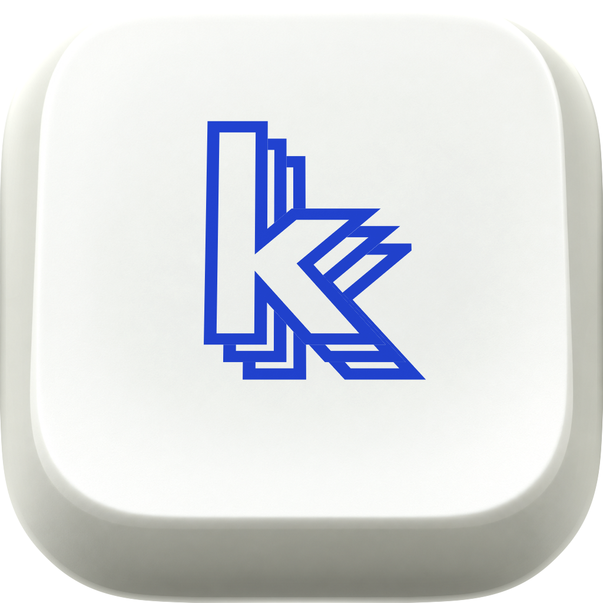

<p align="center">
  
</p>

<h1 align="center">Kudzu</h1>

<p align="center">
  <strong>For things worth repeating</strong><br>
  Clipboard history and text shortcuts for your Mac.<br>
  Free, open source, and built for the keyboard.
</p>

<p align="center">
  <a href="https://github.com/Stringsaeed/kudzu/releases/latest">Download for macOS</a> ·
  <a href="https://kudzu.site">Website</a> ·
  <a href="#get-started">Get started</a> ·
  <a href="#development">Build from source</a>
</p>

<p align="center">macOS 14 Sonoma or later · Apple Silicon and Intel · MIT license</p>

---

Your email address, the reply you send every day, the link you copied ten minutes ago. Kudzu keeps them within reach.

Give a snippet a short trigger, then type it in the app you're using. Kudzu replaces the trigger with your text. When you need something you copied earlier, open clipboard history and search for it.

| You type | Kudzu inserts |
| --- | --- |
| `;email` | `hello@example.com` |
| `;sig` | Your full email signature |
| `;today` | Today's date, in your preferred format |
| `;reply` | A saved reply with a form for the details that change |

You choose the triggers and the text. Create snippets in the editor, or bring your existing library from Espanso.

## Get started

Install with Homebrew:

```sh
brew install --cask stringsaeed/tap/kudzu
```

Or download the universal DMG from [GitHub Releases](https://github.com/Stringsaeed/kudzu/releases/latest), drag Kudzu into Applications, and open it.

1. Follow the setup guide to grant macOS Accessibility access. Kudzu uses it to detect triggers and insert text. The guide also checks the keyboard connection and offers Input Monitoring when needed.
2. Create a snippet with the trigger `;hello` and the content `Hello from Kudzu!`.
3. Open TextEdit and type `;hello` to try your first expansion.

Use **Control + Option + Space** to find a snippet without remembering its trigger. Use **Control + Option + V** to search clipboard history.

Kudzu checks for updates automatically. You can check manually or join the beta channel in **Settings → About**. For help with access, see [permission setup](apps/desktop/docs/PERMISSIONS.md).

## Text shortcuts that do more

Write addresses, signatures, code, and replies once. Reuse them across your Mac, with variables for the parts that change.

- Insert dates, times, clipboard contents, and other snippets. Set where the cursor lands after expansion.
- Add text fields and dropdowns to turn a saved reply into a fill-in form near the caret.
- Organize your library with nested groups, favorites, and multiple triggers per snippet.
- Choose instant or whole-word expansion and propagate the capitalization you type.
- Set app rules for a snippet or an entire group. Choose typing or pasting for apps that need a particular insertion method.
- Press Backspace immediately after an expansion to undo it.

The editor displays variables as editable chips and shows a live preview. Type `/` to insert a variable without learning the syntax.

### A reply with room for the details

Save this as a snippet with the trigger `;followup`:

```text
Hi {{field name="Name"}},

Thanks for getting in touch about {{field name="Topic"}}.
I'll follow up by {{date offset="+2d" format="EEEE, MMMM d"}}.

Best,
Alex
```

When you type `;followup`, Kudzu asks for the name and topic, calculates the date two days ahead, and inserts the completed message.

| Use | Template |
| --- | --- |
| Today's date | `{{date format="yyyy-MM-dd"}}` |
| Clipboard text, trimmed | `{{clipboard trim=true}}` |
| Cursor inside a function call | `console.log({{cursor}});` |
| A dropdown | `{{choice name="Priority" options="Low\|Normal\|High" default="Normal"}}` |

See the [template reference](apps/desktop/docs/TEMPLATE_SYNTAX.md) for formats, offsets, nested snippets, and import compatibility.

## Find what you copied

Clipboard history keeps text, links, code, images, colors, and files, with previews and the app each item came from.

- Search by content, filter by kind, or narrow a search with `app:slack` or `is:image`.
- Pin items you want to keep. Repeated copies share one entry with a copy timeline.
- Paste into the app you were using, or paste as plain text.
- Turn a clipboard item into a reusable snippet.

History stays on your Mac. Unpinned items expire after a week by default, with a configurable retention period and a limit of 5,000 unpinned entries. Pinned items do not expire.

## Your data, on your Mac

Kudzu works without a Kudzu account or subscription. Text expansion and clipboard history work offline, and the app has no analytics.

Your library is stored locally. iCloud sync can keep snippets and groups available on your other Macs; you can turn it off in Settings. Clipboard history does not sync. Automatic update checks use GitHub Releases.

Kudzu skips clipboard items marked concealed or transient and excludes known password managers by default. You can exclude additional apps. Text expansion pauses while macOS Secure Input is active.

Daily local library backups and backups before imports or restores provide a recovery path. Export your snippets to Kudzu JSON or Espanso YAML at any time.

Coming from Espanso? Kudzu imports triggers, dates, clipboard variables, nested matches, and forms. Shell and script variables are imported as literal text with warnings. See the [compatibility table](apps/desktop/docs/TEMPLATE_SYNTAX.md#espanso-mapping-import) for the full mapping.

## Keyboard essentials

These are the default shortcuts in the installed app. The global shortcuts are configurable.

| Action | Shortcut |
| --- | --- |
| Find and insert a snippet | <kbd>⌃</kbd> <kbd>⌥</kbd> <kbd>Space</kbd> |
| Search clipboard history | <kbd>⌃</kbd> <kbd>⌥</kbd> <kbd>V</kbd> |
| Create a snippet in the library | <kbd>⌘</kbd> <kbd>N</kbd> |
| Open the command menu | <kbd>⌘</kbd> <kbd>K</kbd> |
| Show the shortcut cheat sheet | <kbd>⌘</kbd> <kbd>/</kbd> |
| Open Settings | <kbd>⌘</kbd> <kbd>,</kbd> |

## Development

Kudzu uses a Rust expansion engine inside a Tauri 2 app, with a Next.js and shadcn/ui interface. The marketing website lives in the same pnpm workspace. Turborepo runs and caches the frontend tasks.

You need Node.js 22.12 or later and the pnpm version pinned in [`package.json`](package.json). Native app development also requires macOS, stable Rust, and Xcode Command Line Tools.

```sh
git clone https://github.com/Stringsaeed/kudzu.git
cd kudzu
pnpm install
```

Start the desktop UI in a browser:

```sh
pnpm dev:desktop
```

The browser preview uses an in-memory backend. It lets you explore the interface without native permissions; system-wide expansion and real clipboard capture require the native app.

Run the native app on macOS:

```sh
pnpm dev:app
```

This launches **Kudzu Dev**, with separate data and permissions from the installed app. It starts paused and uses **Control + Option + Shift + Space** for snippet search. Pause the installed app before resuming the dev engine to test expansion. See [development variants](apps/desktop/README.md#macos-development-variant) for details.

### Commands

Run these from the repository root:

| Command | Purpose |
| --- | --- |
| `pnpm dev` | Desktop browser preview on port 3000 and website on port 3001 |
| `pnpm dev:website` | Website only |
| `pnpm check` | TypeScript and Oxlint checks for both frontends |
| `pnpm build` | Desktop static export and website production build |
| `pnpm test:rust` | Rust workspace tests on macOS |
| `pnpm lint:rust` | Rust Clippy checks on macOS |

### Repository map

| Directory | What lives here |
| --- | --- |
| [`apps/desktop/`](apps/desktop) | Desktop UI and Tauri shell |
| [`kudzu-core/`](apps/desktop/src-tauri/crates/kudzu-core) | Pure Rust types, templates, trigger matching, interchange, and sync model |
| [`kudzu-engine/`](apps/desktop/src-tauri/crates/kudzu-engine) | macOS keyboard events, insertion, permissions, and caret position |
| [`apps/website/`](apps/website) | The [kudzu.site](https://kudzu.site) marketing website |
| [`packages/`](packages) | Shared TypeScript and Oxlint configuration |

For more detail, read the [desktop guide](apps/desktop/README.md), [website guide](apps/website/README.md), or [release and iCloud guide](apps/desktop/RELEASING.md).

## Contributing

Bug reports, fixes, and improvements are welcome. [Open an issue](https://github.com/Stringsaeed/kudzu/issues) with steps to reproduce, your macOS version, and the app where the problem occurs. Use sample snippet content when sharing a reproduction.

Before making changes, read [AGENTS.md](AGENTS.md) for the project conventions. Run the checks relevant to your change, keep pull requests focused, and use Conventional Commits such as `fix: restore cursor after expansion`.

## License

[MIT](LICENSE). Free to use, modify, and distribute.
